<h1 align="center">Beamlogin</h1>

<p align="center">
  <b>Beam your Claude Code sign-in from your phone to a headless machine.</b><br>
  Scan a QR code, sign in on your phone, and the terminal is signed in. No browser or desktop needed on the machine.
</p>

<p align="center">
  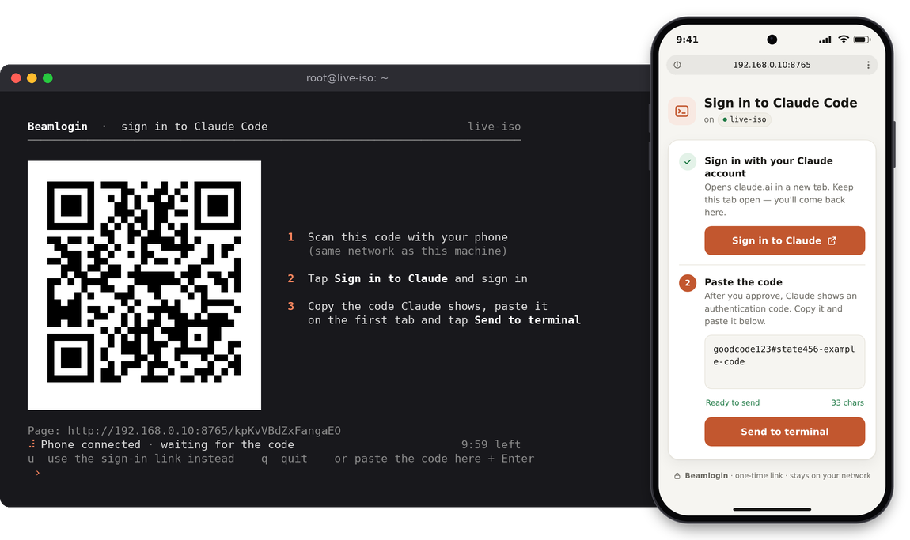
</p>

<p align="center">
  <i>Screenshots in this README use a stand-in for Claude Code and example addresses.</i>
</p>

> [!NOTE]
> **Beamlogin is in beta.** The current release is
> [v0.4.0-beta.1](https://github.com/UnoSee/beamlogin/releases/tag/v0.4.0-beta.1). It works and
> is tested on Linux and Windows, but expect rough edges, especially on macOS. Please
> [report problems](https://github.com/UnoSee/beamlogin/issues).

---

## Contents

- [Why Beamlogin](#why-beamlogin)
- [How it works](#how-it-works)
- [Features](#features)
- [Requirements](#requirements)
- [Install](#install)
- [Quick start](#quick-start)
- [Use cases](#use-cases)
- [Walkthrough](#walkthrough)
- [Command reference](#command-reference)
- [Networking and firewalls](#networking-and-firewalls)
- [Security and privacy](#security-and-privacy)
- [Troubleshooting and FAQ](#troubleshooting-and-faq)
- [Notes and limitations](#notes-and-limitations)
- [Development](#development)
- [Disclaimer](#disclaimer)
- [License](#license)

---

## Why Beamlogin

Signing in to Claude Code opens a sign-in page in a browser. Then you copy a long code back into
the terminal. That's easy on a laptop, but awkward or impossible when the machine is:

- a **live USB or rescue ISO** with only a text console,
- a **server console**: a physical screen, KVM, IPMI or a cloud provider's web console where
  copy and paste don't work,
- a **VM or container** without a browser.

On those machines you'd have to type a URL of several hundred characters by hand, then type the
code back.

Beamlogin fixes that with your phone:

1. It shows a **QR code** in the terminal.
2. You scan it, sign in to Claude on your phone, and paste the code into a page there.
3. The code travels over your local network straight to the terminal, which finishes signing in.

Nothing to type on the machine, no copy and paste between devices, and no relay server.

## How it works

<p align="center">
  <picture>
    <source media="(prefers-color-scheme: dark)" srcset="docs/images/how-it-works-dark.png">
    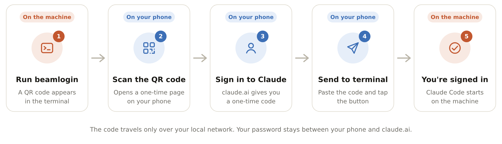
  </picture>
</p>

In detail:

1. Beamlogin runs the official `claude auth login` in a hidden terminal and reads the sign-in
   link Claude Code prints.
2. It starts a tiny web page on the machine, at a random one-time address, and shows that
   address as a QR code.
3. On your phone, the page has a **Sign in to Claude** button that opens claude.ai's own sign-in
   page. After you approve, claude.ai shows a code.
4. You paste the code into the Beamlogin page and tap **Send to terminal**.
5. Beamlogin types the code into Claude Code, checks that the sign-in worked, tells your phone,
   and closes the page.
6. Press Enter and Claude Code starts, signed in.

Your password and your Claude session never touch Beamlogin. You sign in on claude.ai itself,
and the only thing Beamlogin carries is the one-time code that Claude Code asks for.

## Features

- **One small binary for every platform.** About 0.6 MB with no dependencies: no Python, no
  runtime. It runs on Linux (x86_64 and ARM64, statically linked, so it works on minimal live
  ISOs and busybox), macOS (Intel and Apple Silicon) and Windows 10 or later.
- **Two ways to sign in:**
  - **Login mode** (default) uses the normal Claude sign-in.
  - **Token mode** uses a long-lived token made with `claude setup-token`.
- **Works without a shared network too.** Press `u` to show claude.ai's sign-in link itself as a
  QR code, then type the code in.
- **Checks the machine first.** Finds Claude Code even when it isn't on your `PATH`, and offers
  to install it with the official installer if it's missing.
- **Clean terminal UI.** A live status line with a countdown, and a QR code sized to the
  terminal. Falls back to plain output for logs and simple consoles.
- **A polished phone page.** Light and dark mode, live progress, clear errors. It also works with
  JavaScript turned off.
- **Strict security.** One-time page, a 96-bit secret address, a strict Content-Security-Policy,
  and no-referrer. Tokens are never printed. See [Security and privacy](#security-and-privacy).

## Requirements

| What | Details |
|---|---|
| Machine | Linux (x86_64 or ARM64), macOS 11 or later (Intel or Apple Silicon), or Windows 10 version 1809 or later (x86_64) |
| Claude Code | Installed on the machine, or let Beamlogin install it (see below) |
| To install Claude Code | Linux and macOS: `curl`, CA certificates and `bash`, needed by the official installer. Beamlogin shows the command to install them if they're missing. Windows: PowerShell, which is built in |
| Phone | Any phone with a camera and a browser |
| Network | For the phone page, the phone must reach the machine: same Wi-Fi, a phone hotspot, or the same LAN. Without that, use the [direct sign-in link](#no-shared-network-use-the-direct-sign-in-link) |
| Account | A Claude account that can use Claude Code |

## Install

### Option 1: one-line install (recommended)

**Linux and macOS:**

```bash
curl -fsSL https://raw.githubusercontent.com/UnoSee/beamlogin/main/install.sh | sh
```

No `curl`? Use `wget -qO- https://raw.githubusercontent.com/UnoSee/beamlogin/main/install.sh | sh`.

**Windows (PowerShell):**

```powershell
irm https://raw.githubusercontent.com/UnoSee/beamlogin/main/install.ps1 | iex
```

The installer:

1. detects your system and processor (including Apple Silicon under Rosetta and Windows on
   ARM),
2. downloads the matching binary from the newest release, beta releases included,
3. checks it against the release's `SHA256SUMS` and makes sure it runs,
4. installs it as `beamlogin`:

| System | Installs to |
|---|---|
| Linux and macOS, as root | `/usr/local/bin` |
| Linux and macOS, as a normal user | `~/.local/bin`. If that isn't on your `PATH`, it prints the line to add it |
| Windows | `%LOCALAPPDATA%\Programs\beamlogin`, added to your user `PATH`. No administrator rights needed |

It needs no `sudo`. Settings, as environment variables:

| Variable | Effect |
|---|---|
| `BEAMLOGIN_VERSION` | Install a specific release, such as `v0.4.0-beta.1` |
| `BEAMLOGIN_INSTALL_DIR` | Install into another folder |
| `BEAMLOGIN_NO_MODIFY_PATH=1` | Windows only: leave your `PATH` alone |

For example, to install system-wide as a normal user:

```bash
curl -fsSL https://raw.githubusercontent.com/UnoSee/beamlogin/main/install.sh | sudo sh
```

Run the same command again to update. Want to read the script before running it? See
[`install.sh`](install.sh) and [`install.ps1`](install.ps1).

### Option 2: download a release by hand

Ready-made binaries are on the
[releases page](https://github.com/UnoSee/beamlogin/releases/tag/v0.4.0-beta.1). Pick the one for
your machine:

| System | File |
|---|---|
| Linux, Intel or AMD (x86_64) | `beamlogin-x86_64-linux` |
| Linux, ARM64 (Raspberry Pi 4 or 5 with a 64-bit OS, ARM servers) | `beamlogin-aarch64-linux` |
| macOS, Apple Silicon (M1 and later) | `beamlogin-aarch64-macos` |
| macOS, Intel | `beamlogin-x86_64-macos` |
| Windows 10 or 11 | `beamlogin-x86_64-windows.exe` (also runs on Windows on ARM, through emulation) |

Not sure? On Linux or macOS, `uname -m` prints `x86_64`, or `aarch64` / `arm64` for ARM.
`SHA256SUMS` on the same page lets you check the download.

**Linux and macOS.** Download it, changing the file name to match your system:

```bash
curl -fsSL -o beamlogin https://github.com/UnoSee/beamlogin/releases/download/v0.4.0-beta.1/beamlogin-x86_64-linux
```

```bash
sudo install -m 755 beamlogin /usr/local/bin/beamlogin
```

```bash
beamlogin --version
```

No internet on the machine? Copy the file over any way you like, such as a USB stick or `scp`.
On a live ISO you often don't need to install it at all. Run it from where it is:

```bash
chmod +x beamlogin && ./beamlogin
```

On macOS, a file downloaded with a browser is quarantined, and macOS refuses to open it because
it isn't notarized. Clear the flag once (files downloaded with `curl` aren't affected):

```bash
xattr -d com.apple.quarantine /usr/local/bin/beamlogin
```

**Windows.** Download it in PowerShell:

```powershell
irm https://github.com/UnoSee/beamlogin/releases/download/v0.4.0-beta.1/beamlogin-x86_64-windows.exe -OutFile beamlogin.exe
```

Put `beamlogin.exe` in a folder on your `PATH`, or run it from where it is:

```powershell
.\beamlogin.exe --version
```

The first time the phone page starts, Windows Firewall may ask whether to allow Beamlogin on the
network. Allow it on **Private networks**, so your phone can reach the page.

### Option 3: build from source

See [Building](#building). It takes one Docker command, and you don't need Rust installed.

### Installing Claude Code

You don't have to install Claude Code first. If it's missing, Beamlogin says so and offers to run
the official installer for you:

<p align="center">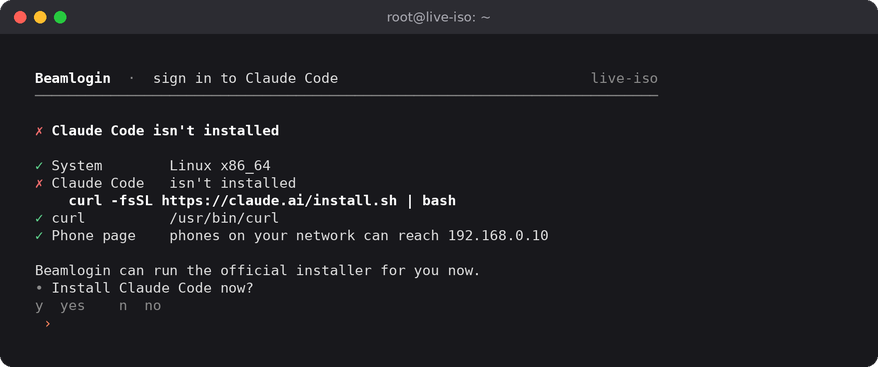</p>

Add `--install-claude` to install it without asking, for example in ISO setup scripts. Beamlogin
runs exactly the command Anthropic documents for your system. On Linux and macOS:

```bash
curl -fsSL https://claude.ai/install.sh | bash
```

On Windows, in PowerShell:

```powershell
irm https://claude.ai/install.ps1 | iex
```

### Uninstall

```bash
beamlogin logout
```

Then delete the binary. If you used the one-line installer:

| System | Delete |
|---|---|
| Linux and macOS | `~/.local/bin/beamlogin`, or `/usr/local/bin/beamlogin` if you installed as root |
| Windows | the folder `%LOCALAPPDATA%\Programs\beamlogin`, and its entry in your user `PATH` |

Otherwise, delete it from wherever you put it.

Beamlogin keeps no settings or data. The only file it ever writes is the optional token file
from `beamlogin token --save` (Linux and macOS), and `beamlogin logout` deletes it.

## Quick start

```bash
beamlogin
```

1. Scan the QR code with your phone. The phone must be on the same network as the machine.
2. Tap **Sign in to Claude** and sign in.
3. Copy the code Claude shows, go back to the Beamlogin tab, paste it, and tap **Send to terminal**.
4. Press **Enter** in the terminal to start Claude Code.

When you're finished with the machine, sign out and revoke the sign-in:

```bash
beamlogin logout
```

Then on your phone: **claude.ai → Settings → Account → Where you're logged in → Log out** on
the matching **Claude Code** row.

## Use cases

### Live USB or rescue ISO

Boot a live system, copy the binary from a USB stick, and sign in with your phone. Nothing is
written to the USB stick, and Claude Code installs itself on the first run.

```bash
/media/usb/beamlogin-x86_64-linux --install-claude
```

When you're done, run `beamlogin logout` and revoke the sign-in on your phone. The live system
forgets everything at shutdown anyway, but revoking is what ends the sign-in on Anthropic's side.

### A server's physical, KVM or IPMI console

You're at the server's own console (in the room, or through a KVM/IPMI viewer), and there's no
way to copy and paste. Beamlogin turns sign-in into scan, tap, paste on your phone:

```bash
beamlogin
```

If the server is on a different network from your phone, use the
[direct sign-in link](#no-shared-network-use-the-direct-sign-in-link) instead.

### Cloud VM web consoles

Browser-based serial consoles often mangle pasted text. Use the direct link, which needs no
network path between your phone and the VM:

```bash
beamlogin --no-server
```

### Containers and VMs on your computer

Publish a fixed port and give Beamlogin your computer's network address, so your phone can reach
the page. Run this in the folder holding the downloaded Linux binary:

```bash
docker run -it --rm -p 8765:8765 -v "$PWD:/opt/beamlogin:ro" debian:bookworm-slim bash
```

Inside the container:

```bash
apt-get update && apt-get install -y curl ca-certificates
```

```bash
/opt/beamlogin/beamlogin-x86_64-linux --ip YOUR_IP --port 8765 --install-claude
```

Replace `YOUR_IP` with your computer's own address on your Wi-Fi or LAN, for example `192.168.0.10`. See
[Networking and firewalls](#networking-and-firewalls).

### Several machines, or machines you set up often

Make one setup token on any computer with a browser:

```bash
claude setup-token
```

Keep it in your password manager. On each machine, `beamlogin token` lets you paste it from your
phone, and your password manager can fill it in. The token works for up to a year until you
revoke it, so treat it like a password.

### Automated ISO or provisioning scripts

Beamlogin is designed to run unattended up to the point where you scan the code:

```bash
beamlogin --install-claude --port 8765 --timeout 900
```

`--plain` gives simple line output if the screen is captured to a log.

## Walkthrough

### Sign in with the phone page

Run `beamlogin`. The terminal shows the QR code with the steps beside it. The live status line at
the bottom tells you when your phone has opened the page and how long you have left.

<p align="center">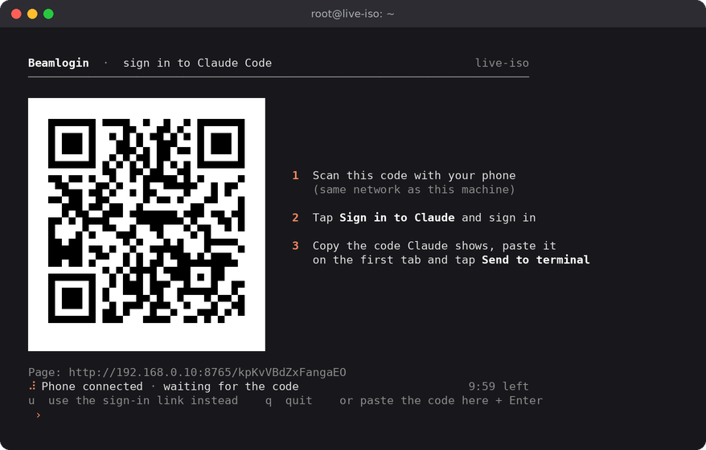</p>

On your phone, the page walks you through the two steps. It checks the code as you paste it, and
then follows the terminal's progress:

<p align="center">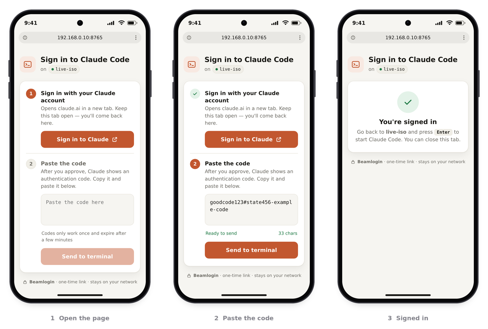</p>

Back in the terminal, Beamlogin confirms the sign-in, shows how to revoke it later, and waits for
Enter to start Claude Code:

<p align="center">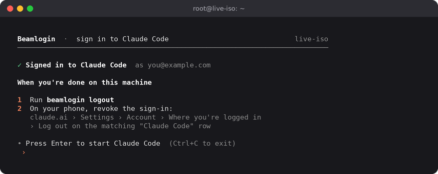</p>

You can also type or paste the code into the terminal instead of the phone page. Paste it at the
`›` prompt and press Enter.

### No shared network? Use the direct sign-in link

If your phone can't reach the machine, for example because it's on mobile data, type `u` and
press Enter. The terminal then shows claude.ai's sign-in link itself as a QR code. Sign in on
your phone, then type the code Claude shows into the terminal. Type `u` again to go back.

<p align="center">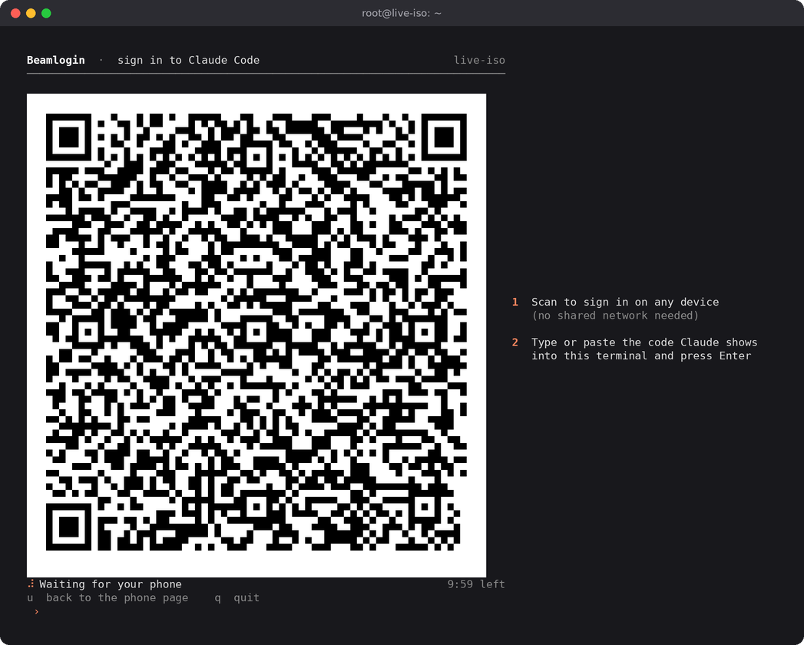</p>

This QR code is much larger because the link is long. It needs a terminal of about 80 columns
by 45 rows. `beamlogin --no-server` starts in this view, with no phone page at all.

### Use a setup token

Setup tokens are long-lived credentials made with `claude setup-token` on any computer that has
a browser. To use one on the headless machine:

```bash
beamlogin token
```

Scan the QR code and paste the token on the page. The field is a password field, so your password
manager can fill it in. Beamlogin checks the token with a tiny test request, then starts Claude
Code with `CLAUDE_CODE_OAUTH_TOKEN` set. Nothing is written to disk unless you ask for `--save`.

<p align="center">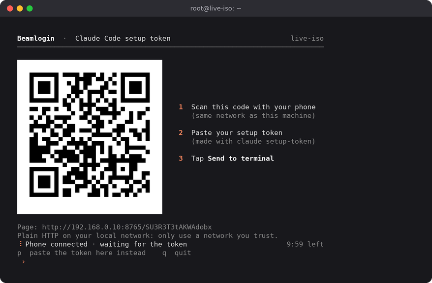</p>

<p align="center">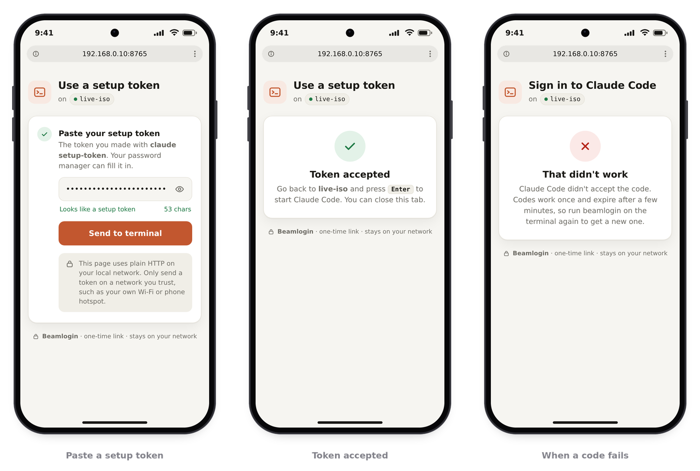</p>

<p align="center">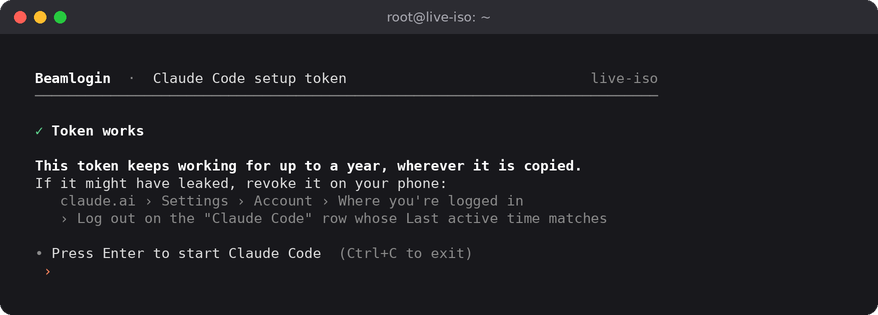</p>

To paste the token in the terminal instead of on the phone, use `beamlogin token --hidden-input`.
The input stays hidden.

### Check the machine

`beamlogin doctor` checks everything Beamlogin and Claude Code need, and says how to fix
anything that's missing:

<p align="center">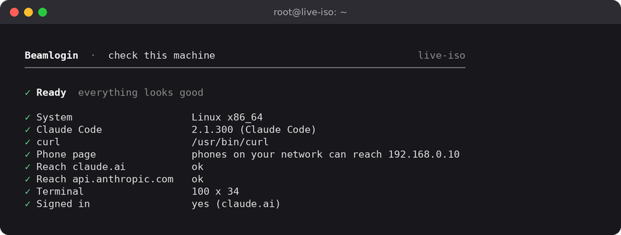</p>

### Sign out

```bash
beamlogin logout
```

<p align="center">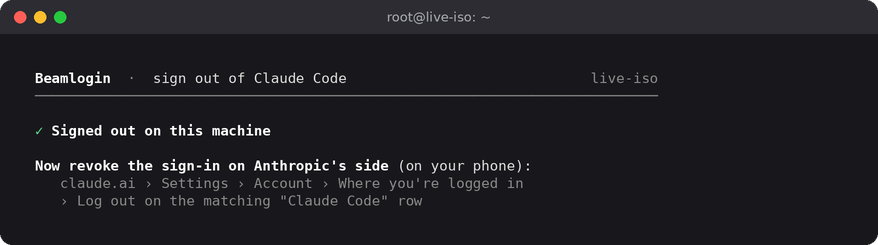</p>

`claude auth logout` removes the sign-in from this machine. To end it on Anthropic's side too, go
to **claude.ai → Settings → Account → Where you're logged in** and choose **Log out** on the
matching **Claude Code** row.

### Dark mode

The phone page follows your phone's light or dark setting:

<p align="center">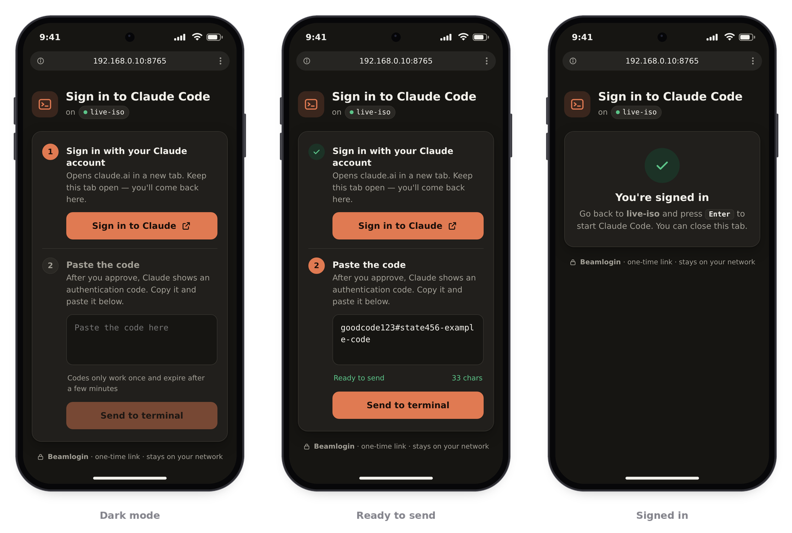</p>

## Command reference

```
beamlogin [login] [options]   sign in with your phone (the default)
beamlogin token [options]     use a setup token sent from your phone
beamlogin logout [options]    sign out here and show how to revoke
beamlogin doctor [options]    check this machine
beamlogin qr [options] TEXT   print any text as a terminal QR code
beamlogin --version
beamlogin [command] --help
```

### Options for every command

| Option | Default | What it does |
|---|---|---|
| `--claude PATH` | `claude` | The Claude Code command or path to use |
| `--qr-style half\|ascii` | `half` | `half` draws compact block characters. `ascii` draws wider colour blocks, for consoles without block characters |
| `--plain` | off | Plain line-by-line output with no screen redraws, for logs and simple consoles |

### Options for `login` and `token`

| Option | Default | What it does |
|---|---|---|
| `--ip ADDR` | auto-detect | The address the phone should use. Set it when auto-detect picks the wrong network, or in a container |
| `--port N` | random | The port for the phone page. Use a fixed port when a firewall or Docker needs one |
| `--bind ADDR` | `0.0.0.0` | The address the page listens on |
| `--no-server` | off | Don't start the phone page. Login mode shows the direct sign-in link instead. Token mode asks for the token in the terminal |
| `--timeout SECONDS` | `600` | How long to wait before giving up |
| `--no-launch` | off | Sign in only. Don't start Claude Code afterwards |
| `--install-claude` | off | If Claude Code is missing, install it with the official installer without asking |

### Options for `login` only

| Option | What it does |
|---|---|
| `--force` | Sign in again, even if Claude Code is already signed in |
| `--keep-browser` | Let Claude Code try to open a local browser. By default Beamlogin sets `BROWSER` to `false` so nothing opens inside the hidden terminal |
| `--verbose` | Echo Claude Code's raw login output to stderr, for debugging |
| `--claude-args …` | Pass everything after it to `claude auth login`, e.g. `--claude-args --console` to sign in with a Console account. Must come last |

### Options for `token` only

| Option | What it does |
|---|---|
| `--hidden-input` | Paste the token in the terminal (hidden) instead of on the phone page |
| `--save` | Also save the token to `$XDG_RUNTIME_DIR/beamlogin-UID/token.env` (or `/dev/shm` or `/tmp`). The file is owner-only and memory-backed where possible. Other shells can `source` it. `beamlogin logout` deletes it. Linux and macOS only |
| `--no-verify` | Skip the test request that checks the token |

### Options for `qr`

| Option | Default | What it does |
|---|---|---|
| `--ecl L\|M\|Q\|H` | `M` | Error-correction level |
| `--` | | Ends the options, so text starting with `-` works: `beamlogin qr -- -text` |

### Keys while waiting

| Key | What it does |
|---|---|
| `u` + Enter | Switch between the phone page and the direct sign-in link (login mode) |
| `p` + Enter | Paste the token in the terminal instead (token mode) |
| `q` + Enter, Ctrl+C or Ctrl+D | Cancel. The phone page is told, then closed |
| A code + Enter | Use a sign-in code typed or pasted into the terminal (login mode) |

### Exit status

| Code | Meaning |
|---|---|
| `0` | Success, or already signed in. `doctor`: ready. `logout`: Claude Code's own exit status |
| `1` | Sign-in failed, was cancelled or timed out; a requirement is missing; or `doctor` found a problem |
| `2` | Invalid command-line options |

With `--no-launch` off, a successful run doesn't exit: Beamlogin replaces itself with Claude Code.

### Environment

| Variable | Effect |
|---|---|
| `NO_COLOR` | Turns off colours |
| `TERM=linux` | The Linux text console: Beamlogin uses plain ASCII symbols it can display |
| `TERM=dumb` | Plain line output, like `--plain` |
| `XDG_RUNTIME_DIR` | Where `token --save` puts the token file |
| `CLAUDE_CODE_OAUTH_TOKEN` | Set for Claude Code by token mode. `logout` warns if it's still set in your shell |

## Networking and firewalls

The phone page is a small web server on the machine. Your phone must be able to reach it:

- **Same network.** The phone and the machine must be on the same Wi-Fi or LAN, or the machine
  must be on your phone's hotspot. Guest networks and "client isolation" on some routers block
  this.
- **The address in the QR code.** Beamlogin picks the address the machine uses to reach the
  internet. If the machine has several networks, choose one with `--ip`.
- **Firewalls.** The default port is random, so use a fixed one and open it:

  ```bash
  beamlogin --port 8765
  ```

  ```bash
  sudo ufw allow 8765/tcp
  ```

  ```bash
  sudo firewall-cmd --add-port=8765/tcp
  ```

- **Docker.** Publish the port with `-p 8765:8765`, use `--port 8765`, and set `--ip` to the
  **host's** network address, not the container's.
- **Windows.** Windows Firewall must allow Beamlogin, or the port, for the network profile
  you're on (Private or Public). Allow it when Windows asks. To open a fixed port yourself, run
  this in an administrator PowerShell, then use `--port 8765`:

  ```powershell
  New-NetFirewallRule -DisplayName Beamlogin -Direction Inbound -Protocol TCP -LocalPort 8765 -Action Allow -Profile Private
  ```

  Inside WSL 2, the default NAT networking can't be reached from your phone. Run the Windows
  binary instead, or use WSL's mirrored networking mode.
- **macOS.** If the macOS firewall is on, it asks whether to allow incoming connections the
  first time. Click **Allow**.

If nothing works, skip the network completely: type `u`, or run `beamlogin --no-server`.

## Security and privacy

**The phone page:**

- **One-time page.** The address contains a random 96-bit secret, so it can't be guessed. The page
  accepts exactly one submission, then closes. It shuts itself down after 20 requests with a wrong
  secret, or after `--timeout` seconds.
- **Strict browser security headers.**
  - A Content-Security-Policy allows only the page's own script and style, tagged with a fresh
    nonce on each response.
  - The page can't be framed and makes no outside requests. It loads no fonts, images or
    analytics.
  - `Referrer-Policy: no-referrer` stops the secret page address from reaching claude.ai when you
    tap the sign-in button.
- **No relay server.** The phone talks straight to the machine over your network. Nothing goes
  through a third party.

**Plain HTTP on the local network.** Someone listening on the same network could see what you
send:

- **Login mode is low risk.** The code works once, expires within minutes, and is useless
  without a secret that never leaves the terminal.
- **Token mode is higher risk.** A setup token works for up to a year from anywhere. Only use
  token mode on a network you trust (your own Wi-Fi or a phone hotspot), or use
  `--hidden-input`.

**Your credentials:**

- **Beamlogin never sees your password or your Claude session.** You sign in on claude.ai itself.
  Beamlogin only passes the one-time code to the official `claude auth login`. It never reads,
  copies or stores the sign-in Claude Code saves.
- **Tokens are never printed or logged.** They're also scrubbed from error output.
- **Tokens stay in memory.** Nothing is written to disk unless you use `--save`, which writes an
  owner-only file in memory-backed storage where available.

**If a sign-in or token might have leaked,** revoke it: claude.ai → **Settings → Account →
Where you're logged in** → **Log out** on the Claude Code row whose *Last active* time matches.
To check that a token is dead:

```bash
CLAUDE_CODE_OAUTH_TOKEN=... claude -p "say ok"
```

## Troubleshooting and FAQ

**My phone can't open the page.**
The phone and the machine aren't reaching each other. Check, in order:

1. They're on the same network, and it's not a guest network.
2. A firewall allows the port. Use `--port 8765` and open it.
3. The address in the QR code is right. Fix it with `--ip`.
4. In Docker, the port is published and `--ip` is the host's address.

Or skip the network: type `u`.

**The QR code doesn't fit, or my phone won't read it.**
Make the terminal bigger, or use a smaller console font, for example with `setfont`. The phone
page QR code needs about 40 columns, and the direct-link QR code about 80. If block characters
look broken on your console, try `--qr-style ascii`.

**"Sign-in failed. Claude Code said: … Invalid code".**
Sign-in codes work once and expire after a few minutes. Run `beamlogin` again for a new one, and
paste the code soon after Claude shows it.

**"Still waiting for a sign-in link".**
Claude Code didn't print a sign-in link within 25 seconds. Beamlogin shows what Claude Code
printed instead. Usually it's a network problem (`beamlogin doctor` checks this) or a newer Claude
Code that prints its sign-in differently. `--verbose` shows the raw output.

**"Claude Code is already signed in".**
Use `--force` to sign in again, or run `beamlogin logout` first.

**"The token did not work".**
The token is expired, revoked or mistyped. Make a new one with `claude setup-token`.

**Does `/logout` in Claude Code revoke the sign-in?**
It removes the sign-in from the machine, but may not end it on Anthropic's side. Revoke it on
claude.ai as shown above.

**Does it work over SSH?**
Yes, but you usually don't need it there: over SSH you can copy the sign-in link to your own
computer's browser. Beamlogin is for consoles where you can't.

**Does Beamlogin send anything to the internet?**
No. Beamlogin itself only talks to your phone over the local network. Claude Code talks to
Anthropic as usual. `beamlogin doctor` opens a connection to `claude.ai` and `api.anthropic.com`
to check they're reachable, but sends no data.

**Can I use a Console (API billing) account?**
Pass Claude Code's own option through: `beamlogin --claude-args --console`.

## Notes and limitations

- **It depends on Claude Code's sign-in text.** Beamlogin runs `claude auth login` in a pseudo-
  terminal 1000 columns wide, so the link isn't wrapped. It looks for the sign-in link and the
  `Paste code here if prompted` prompt. If a future Claude Code changes this, Beamlogin shows what
  Claude printed instead of guessing. Fixing it means updating `find_auth_url()` in
  [`src/util.rs`](src/util.rs).
- **Platform testing.** The full test suite runs on every supported system in
  [CI](#releasing). Linux and Windows have also been used by hand with the real Claude Code;
  macOS has had less hands-on use so far. Please report any problems.
- **Windows differences.**
  - Beamlogin uses the Windows pseudo console (ConPTY), so it needs Windows 10 version 1809 or
    later.
  - `token --save` isn't available. Set `CLAUDE_CODE_OAUTH_TOKEN` yourself if you need the token
    in other windows.
  - Claude Code starts as a child of Beamlogin instead of replacing it, because Windows can't
    replace a running program. You won't notice a difference.
- **No local browser.** Beamlogin sets `BROWSER=false` for Claude Code, so it never tries to open
  a text browser such as `w3m` inside the hidden terminal. `--keep-browser` turns this off.
- **Signing in replaces Beamlogin with Claude Code.** After the sign-in, Beamlogin starts Claude
  Code in the same terminal, as if you had typed `claude`.
- **The phone page is in English.**

## Development

### Project layout

```
src/
  main.rs     command line, the login/token/logout/doctor/qr commands
  ui.rs       terminal UI: header, QR panel, live footer, keyboard input
  relay.rs    the one-time phone page (a small HTTP server)
  qr.rs       QR code encoder (byte mode, versions 1-40) and terminal renderer
  checks.rs   dependency checks (doctor and the start-up check)
  util.rs     helpers: escape sequences, validation, JSON, processes
  sys/        everything that differs by operating system:
    unix.rs     Linux and macOS: pseudo-terminal, raw keyboard input, signals
    windows.rs  Windows: ConPTY pseudo console, console input, Ctrl+C handling
assets/       the phone page's HTML, CSS and JS, compiled into the binary
build/        the cross-compile toolchain (Dockerfile) and release build script
tests/        end-to-end tests and a stand-in for Claude Code
docs/         README images and the scripts that make them
.github/      the release workflow
```

The only dependencies are the `libc` crate on Linux and macOS, and `windows-sys` on Windows. The
HTTP server, QR encoder, JSON reader and argument parser are all built in, so the binary stays
small and easy to audit.

### Building

The release build runs in Docker, so you don't need Rust installed. It builds all five binaries
into `dist/`, from any machine that runs Docker. First build the toolchain image (once):

```bash
docker build -t beamlogin-build build
```

Then build the binaries:

```bash
docker run --rm -v "$PWD:/src" beamlogin-build sh build/build.sh
```

The image uses [cargo-zigbuild](https://github.com/rust-cross/cargo-zigbuild) to link the Linux
and macOS binaries, and MinGW for Windows. The Apple Silicon binary is ad-hoc signed, which is
all macOS needs to run it.

With Rust installed, build for your own machine directly:

```bash
cargo build --release
```

### Releasing

[`.github/workflows/release.yml`](.github/workflows/release.yml) runs on every push and pull
request. It:

1. builds all five binaries with the Docker toolchain,
2. runs the end-to-end tests with each binary on its own system: Linux x86_64 and ARM64, macOS on
   Apple Silicon and Intel, and Windows,
3. for a version tag only, publishes a GitHub release with the binaries and a `SHA256SUMS` file
   attached.

Set `version` in `Cargo.toml` first, then tag to match. The workflow refuses a tag that doesn't
match:

```bash
git tag v0.4.0-beta.1
```

```bash
git push origin v0.4.0-beta.1
```

A tag with a hyphen, such as `-beta.1` or `-rc.1`, is published as a **pre-release**. A plain
tag such as `v1.0.0` is published as a normal release.

### Tests

Both test scripts need Python 3, for the tests only. They run against `tests/fake_claude`, a
stand-in for the real Claude Code, so no account is used.

```bash
python3 tests/test_flows.py
```

On Windows, run `py tests\test_flows.py`.

- `tests/test_flows.py` runs every flow end to end against the `dist/` binary for the system
  it runs on (`beamlogin-x86_64-linux` or `beamlogin-x86_64-windows.exe`):
  - login through the phone page, a typed code, and a wrong code,
  - logout,
  - token mode, a revoked token and `--save` (on Windows, that `--save` is refused clearly),
  - the shutdown after 20 wrong requests,
  - the page's JSON and live status,
  - the dependency checks.
  
  Set `BEAMLOGIN_BIN` to test another binary.
- `tests/compare.py` checks this version against the earlier Python version (0.1.0), output for
  output. It compares QR codes, every phone page and JSON reply, and terminal text:

  ```bash
  python3 tests/compare.py /path/to/python/beamlogin
  ```

### Screenshots

The images in `docs/images` are generated. See [`docs/screenshots`](docs/screenshots) to
regenerate them.

## Disclaimer

**Beamlogin is an independent, unofficial project.** It isn't made, endorsed, sponsored or
supported by Anthropic. "Claude", "Claude Code" and "Anthropic" are trademarks of Anthropic, used
here only to describe what this tool works with.

- **Use at your own risk.** Beamlogin is provided "as is", without warranty of any kind. See
  the [license](#license). The authors aren't responsible for any loss, account problem, or
  security incident from using it.
- **You're responsible for your account.** Use Beamlogin in line with Anthropic's terms of
  service and usage policies, and with the rules of the network and machines you use it on.
  Revoke sign-ins and tokens you no longer need.
- **It drives the official tools only.** Beamlogin doesn't contain, copy or modify any of
  Anthropic's software. It runs the official `claude` command, and, only if you agree, the
  official installer (`https://claude.ai/install.sh`, or `https://claude.ai/install.ps1` on
  Windows), exactly as Anthropic documents it.
- **It may stop working.** Beamlogin relies on how Claude Code signs in today. A future Claude
  Code release may change that.
- **Screenshots are illustrative.** The images in this README were made with a stand-in for
  Claude Code and example addresses, not a real account.

## License

MIT. See [LICENSE](LICENSE).
